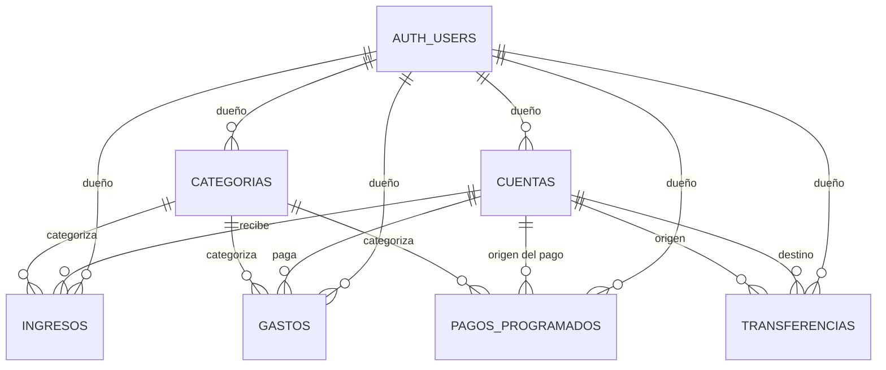

# OpenFinanceKit

**Documento:** Diccionario de Datos
**Versión:** 0.3.0
**Estado:** Vigente
**Release descrito:** v0.3.0 (pendiente de publicar)
**Autor:** Gustavo Echeverría
**Última actualización:** 2026-10-16

---

> **Nota de revisión.** Hasta el 2026-10-16 este documento describía un ERP contable
> (`cuenta_contable`, `asiento_contable`, `factura`, `tercero`, `presupuesto`) que
> **nunca existió en este proyecto**. Era visión, no implementación. El contenido de
> abajo es el esquema real de producción, verificado contra
> `apps/web/supabase/migrations/`. La visión de ERP se conserva en el
> [Anexo](#anexo-visión-no-implementada) al final, claramente marcada.

---

## Resumen

| Tabla | Qué guarda | Origen |
|-------|-----------|--------|
| `categorias` | Tipos de ingreso y gasto | Migración 001 |
| `cuentas` | Cuentas con saldo inicial | Migración 001 |
| `ingresos` | Movimientos de dinero que entran | Migración 001 |
| `gastos` | Movimientos de dinero que salen | Migración 001 |
| `pagos_programados` | Plantillas de pagos recurrentes | Migración 005, 007, 009 |
| `transferencias` | Movimiento de saldo entre cuentas | Migración 003 |

**Tablas eliminadas:** `pagos` (migración 008, dentro de v0.3.0).

Todas las tablas:
- tienen `user_id` con `ON DELETE CASCADE` sobre `auth.users`
- tienen Row Level Security activo: cada usuario solo ve lo suyo
- usan `SERIAL` para la PK, no UUID

---

## Diagrama entidad-relación



---

## Datos maestros

Las únicas dos fuentes de datos maestros. Nada se puede capturar sin una de las dos
(ver RN-001 en `BUSINESS_RULES.md`).

### `categorias`

| Columna | Tipo | Null | Default | Notas |
|---------|------|------|---------|-------|
| `id` | SERIAL | No | — | PK |
| `nombre` | TEXT | No | — | |
| `tipo` | TEXT | No | — | CHECK: `'Ingreso'` \| `'Gasto'` |
| `user_id` | UUID | No | — | FK → `auth.users(id)` CASCADE |
| `created_at` | TIMESTAMPTZ | No | `NOW()` | |

Índices: `idx_categorias_user (user_id)`, `idx_categorias_tipo (user_id, tipo)`

`ON DELETE RESTRICT` cuando es referenciada por `ingresos`, `gastos` o
`pagos_programados`. Borrar una categoría con movimientos debe fallar y avisar, no
dejar registros huérfanos.

### `cuentas`

| Columna | Tipo | Null | Default | Notas |
|---------|------|------|---------|-------|
| `id` | SERIAL | No | — | PK |
| `nombre` | TEXT | No | — | |
| `saldo_inicial` | DECIMAL(12,2) | No | `0` | CHECK `>= 0` |
| `user_id` | UUID | No | — | FK → `auth.users(id)` CASCADE |
| `created_at` | TIMESTAMPTZ | No | `NOW()` | |

Índice: `idx_cuentas_user (user_id)`

**"Efectivo" es una fila más de esta tabla**, con su propio saldo. No es un caso
especial en el código. El seed la crea al configurar por primera vez; su saldo se
alimenta con filas en `transferencias`.

---

## Movimientos

### `ingresos`

| Columna | Tipo | Null | Notas |
|---------|------|------|-------|
| `id` | SERIAL | No | PK |
| `fecha` | DATE | No | |
| `categoria_id` | INTEGER | No | FK → `categorias(id)` |
| `cuenta_id` | INTEGER | No | FK → `cuentas(id)` |
| `valor` | DECIMAL(12,2) | No | CHECK `> 0` |
| `descripcion` | TEXT | **Sí** | |
| `user_id` | UUID | No | FK → `auth.users(id)` CASCADE |
| `created_at` | TIMESTAMPTZ | No | `NOW()` |

Índices: `idx_ingresos_user (user_id)`, `idx_ingresos_fecha (user_id, fecha)`

### `gastos`

Estructura idéntica a `ingresos`. Comparten los mismos tipos de columna y las mismas
restricciones.

Índices: `idx_gastos_user (user_id)`, `idx_gastos_fecha (user_id, fecha)`

### `transferencias`

| Columna | Tipo | Null | Notas |
|---------|------|------|-------|
| `id` | SERIAL | No | PK |
| `origen_id` | INTEGER | No | FK → `cuentas(id)` **ON DELETE RESTRICT** |
| `destino_id` | INTEGER | No | FK → `cuentas(id)` **ON DELETE RESTRICT** |
| `valor` | DECIMAL(12,2) | No | CHECK `> 0` |
| `fecha` | DATE | No | |
| `concepto` | TEXT | **Sí** | CHECK `char_length <= 255` |
| `user_id` | UUID | No | FK → `auth.users(id)` CASCADE |
| `created_at` | TIMESTAMPTZ | No | `NOW()` |

Restricción de tabla: `CHECK (origen_id <> destino_id)` — transferir a la misma cuenta
sería un bucle sin efecto.

Índices: `idx_transferencias_user (user_id, fecha)`,
`idx_transferencias_origen (user_id, origen_id)`,
`idx_transferencias_destino (user_id, destino_id)`

**Una transferencia no altera el saldo global.** Solo redistribuye: el Motor resta
donde `origen_id` y suma donde `destino_id`, de modo que la suma de saldos por cuenta
sigue cuadrando con el saldo global.

**El saldo insuficiente no se valida en la base.** Requiere leer el saldo actual de la
cuenta, que es un cálculo y no un dato de la fila. Se valida en la server action antes
de insertar.

---

## Pagos programados

### `pagos_programados`

| Columna | Tipo | Null | Default | Notas |
|---------|------|------|---------|-------|
| `id` | SERIAL | No | — | PK |
| `concepto` | TEXT | No | — | CHECK `char_length` entre 1 y 255 |
| `valor` | DECIMAL(12,2) | No | — | CHECK `> 0` |
| `recurrencia` | TEXT | No | — | CHECK: `'Mensual'` \| `'Quincenal'` \| `'Semanal'` |
| `tipo` | TEXT | No | — | CHECK: `'Gasto'` \| `'Ingreso'` — a qué lado del historial va |
| `cuenta_id` | INTEGER | No | — | FK → `cuentas(id)` **ON DELETE RESTRICT** |
| `categoria_id` | INTEGER | No | — | FK → `categorias(id)` **ON DELETE RESTRICT** |
| `fecha_inicio` | DATE | No | — | |
| `dia_vencimiento` | INTEGER | No | — | CHECK entre 1 y 31 |
| `activo` | BOOLEAN | No | `TRUE` | `FALSE` = desactivado, no borrado |
| `fecha_ultimo_pago` | DATE | **Sí** | — | `NULL` = nunca se pagó |
| `user_id` | UUID | No | — | FK → `auth.users(id)` CASCADE |
| `created_at` | TIMESTAMPTZ | No | `NOW()` | |
| `updated_at` | TIMESTAMPTZ | No | `NOW()` | |

Índices: `idx_pagos_programados_user (user_id, activo)`,
`idx_pagos_programados_vencimiento (user_id, dia_vencimiento)`,
`idx_pagos_programados_categoria (categoria_id)`

#### Lo que esta tabla NO tiene, y por qué

**No hay columna `estado`.** El estado ("Al día", "Pendiente", "Alerta", "Vencido") **se
calcula en cada render** a partir de `fecha_ultimo_pago`, `dia_vencimiento`,
`recurrencia` y la fecha de hoy.

Razón: es lo que permite que la plantilla se renueve sola sin un job programado. No hay
estado que "venza", solo fechas que ya están. El cálculo vive en
`src/lib/motor/fechas.ts` (`calcularEstadoProgramado`) y
`src/lib/motor/programados.ts` (`hornearPagosProgramados`).

**No hay columna "borrado".** Desactivar es `activo = FALSE`. No hay borrado: la
decisión es del usuario y está documentada en la migración `009`.

#### Notas de diseño

- **`dia_vencimiento` va separado de `fecha_inicio`** para que el cálculo del próximo
  vencimiento no dependa de parsear la última fecha pagada. Para el día 31 en meses
  cortos se usa el último día del mes.
- **"Quincenal" es por fechas de mes**, no 15 días corridos: el día configurado y ese
  día + 15. Con 15 días corridos un arriendo se iría del 31 al 15 y cada mes se
  movería.
- **No existe `'Diario'`.** Con un ciclo de 1 día la ventana de alerta de 5 días no
  cabe dentro del ciclo: el pago caería en alerta de forma permanente, incluso recién
  pagado. Ver migración `007`.
- **`ON DELETE RESTRICT` en `cuenta_id` y `categoria_id`:** si se borra una cuenta o
  una categoría que tiene pagos programados, estos quedarían huérfanos. El usuario
  tiene que desactivar el pago programado primero.

---

## Tablas eliminadas

### `pagos` — eliminada en la migración `008`

Modelaba un compromiso de pago **de una sola vez**. Nunca funcionó: el código
intentaba insertar `pagos.cuenta_id`, pero la migración que la creaba (002) nunca se
aplicó, así que el formulario fallaba siempre con *"No se pudo guardar el pago.
Intenta de nuevo."*

Los 5 pagos pendientes del usuario se convirtieron a mano en pagos programados antes de
dropear la tabla. Ninguno estaba en estado "Pagado", así que ningún saldo cambió.

---

## Row Level Security

RLS está activo en las 6 tablas. Para todas, la política es la misma:

```sql
USING (auth.uid() = user_id)              -- SELECT y UPDATE
WITH CHECK (auth.uid() = user_id)         -- INSERT
USING (auth.uid() = user_id)              -- DELETE
```

Migraciones: `001` (categorias, cuentas, ingresos, gastos),
`004` (transferencias), `006` (pagos_programados).

**Deben estar las 4 políticas por tabla.** Si falta la de `DELETE`, el usuario puede
leer y modificar datos ajenos aunque no puede crearlos.

---

## Convenciones

| Convención | Valor |
|------------|-------|
| PK | `SERIAL` (no UUID) |
| FK del propietario | `user_id UUID` → `auth.users(id)` CASCADE |
| Nombres | `snake_case` |
| Fechas de negocio | `DATE` (sin hora) |
| Marcas de tiempo | `TIMESTAMPTZ` |
| Montos | `DECIMAL(12,2)` — nunca `FLOAT` |
| Enums | `TEXT` con `CHECK`, no tipo ENUM de Postgres |
| Booleanos | `activo` |
| Índices de ownership | siempre empiezan por `user_id` |

---

## Anexo: visión no implementada

La investigación de agosto de 2026 exploró un OFK empresarial con contabilidad bajo
partida doble, facturación, presupuestos, centros de costo y terceros. **Nada de esto
existe en el código.** Se documenta aquí solo para no perder el contexto de a dónde
podría ir el proyecto.

| Entidad | Estado |
|-----------|--------|
| `cuenta_contable` (plan de cuentas jerárquico) | ❌ No implementada |
| `asiento_contable` + `linea_asiento` (partida doble) | ❌ No implementada |
| `factura` + `linea_factura` | ❌ No implementada |
| `presupuesto` | ❌ No implementada |
| `periodo_contable` | ❌ No implementada |
| `centro_costo` | ❌ No implementada |
| `tercero` | ❌ No implementada |

Si alguien retoma esa visión, es un proyecto aparte: cambia el modelo de datos entero,
el Motor y la arquitectura. No es una evolución incremental de lo que hay.